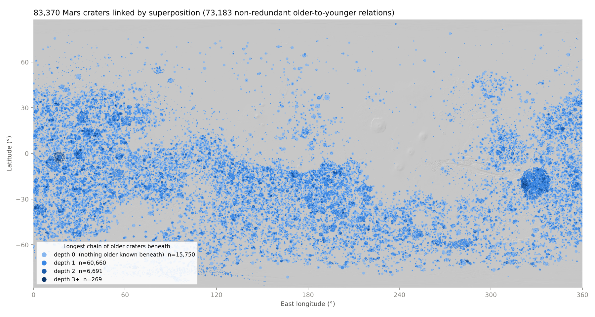
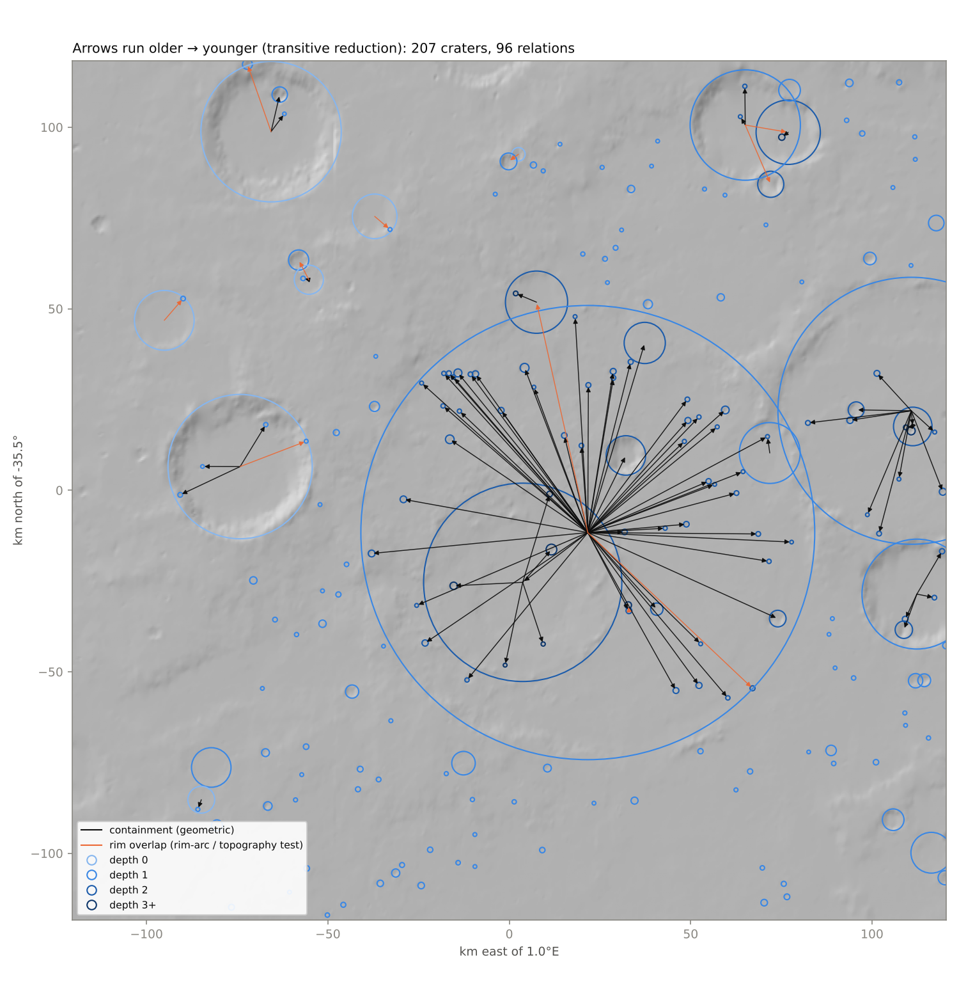
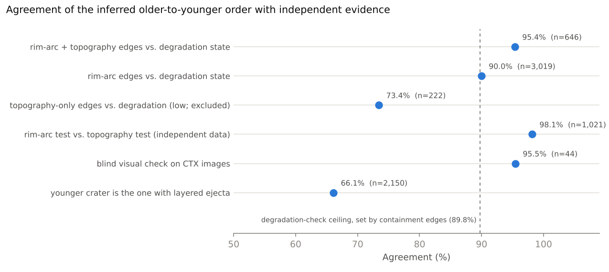

# Mars crater superposition graph

**Interactive explorer:** https://michael-s-phillips.github.io/mars-crater-graph/

This project builds a directed graph of Mars impact craters in which every edge records that one crater formed after another. Nodes are craters from the Robbins and Hynek (2012) database (2020 release, 385,049 craters ≥1 km). An edge `A → B` means crater B is stratigraphically younger than crater A, because B sits inside A's rim or because B's rim cuts A's rim. The first full run links 83,370 craters through 77,661 relations, and the graph contains no cycles.

An interactive map explorer comes with the data. Clicking a crater shows every crater known to be older or younger than it and draws its stratigraphic column. The explorer is plain HTML and JavaScript with no server or account. Open `explorer/index.html` from disk, publish the repository with GitHub Pages, or share `dist/mars_crater_graph_explorer.html`, a single 5 MB file with the data built in. The full explorer draws a tiled basemap: the THEMIS daytime infrared mosaic down to ~230 m/pixel, or HRSC–MOLA shaded relief down to ~460 m/pixel. Cataloged craters with no relation in the graph (301,679 of 385,049) are drawn as gray circles; clicking one gives the reason: no cataloged neighbor (146,425), only on or near another crater's ejecta (141,182), overlapping rims that neither test could order (10,889), rims that barely touch (2,849), a topography-only relation (323), or a nested pair set aside (11).

## Results of the first run

| Quantity | Value |
|---|---|
| Craters in the catalog | 385,049 |
| Craters linked by at least one relation | 83,370 |
| Relations (older → younger) | 77,661 |
| Relations after transitive reduction | 73,183 |
| Containment relations | 61,975 |
| Rim-overlap relations (rim-arc test, alone or confirmed by topography) | 15,686 |
| Cycles found | 0 |
| Weakly connected clusters | 14,415 (largest: 6,146 craters, inside the 1,088 km basin 07-4-043926) |
| Longest superposition chain | 5 craters |

Participation in the graph rises with crater size. About 18% of 1–2 km craters are linked, compared with 79% of 20–50 km craters and 99% of craters larger than 50 km. Participation also rises with terrain age. About 27% of craters on Noachian units (Tanaka et al., 2014) are linked, compared with 12% on Hesperian units and 5% on Amazonian units, and among linked craters, chains of three or more craters are about eight times more common on Noachian terrain than on Amazonian terrain (8.6% versus 1.1%). Older, more densely cratered surfaces record more superposition, which is the pattern a working stratigraphic graph should show.



## How relations are inferred

Each crater pair within three crater radii of the larger crater is classified by how the two rim circles relate. The classification and the evidence used for each class are described below.

**Containment.** When the smaller crater lies entirely inside the larger crater's rim, the smaller crater must be younger, because the larger impact would have erased anything inside its rim. These edges are treated as certain. Two exceptions are flagged instead of trusted: nearly identical concentric circles, which are usually duplicate catalog entries, and large nested circles with ring-like diameter ratios (0.3–0.9) and nearly common centers, which are more likely the peak ring or inner ring of a single basin (18 pairs).

**Rim overlap.** When the two rims cross, one crater truncates the other, and geometry alone cannot say which. Two independent tests decide the direction.

- *Rim-arc completeness (catalog test).* Robbins recorded the fraction of each rim he could trace in THEMIS daytime IR (`ARC_IMG`). If a crater is the older member of a pair, the part of its rim lying inside the other crater should be missing. The test compares each crater's missing rim fraction with the fraction of its rim that lies inside its partner. A call that the larger crater is younger requires evidence on both rims, because one-sided calls of that kind proved unreliable.
- *Rim continuity (topography test).* The rim of the younger crater stays a ridge where it crosses the older crater, while the older rim is erased there. For each crater, rim prominence (crest height relative to the inner wall at 0.7 r and the outer flank at 1.35 r) is measured on MOLA 128 pixel/degree topography along every azimuth. The median prominence on the arc inside the partner is divided by the median prominence elsewhere on the rim. The ratio is near 1 for an intact rim and near 0 for a breached rim. The test is applied only when the smaller crater is at least 3 km across.

Rim-overlap edges enter the default graph when the rim-arc test decides (14,684 edges) or when both tests agree (1,002 edges). Edges decided by topography alone (496) are kept in `edges.csv` with low confidence and are excluded from the default graph, because they agreed with degradation states much less often (see below). The 19 pairs where the two tests disagree are left unoriented.



## Validation

Four independent checks were run on the oriented edges. The results are summarized in the figure and in `outputs/validation.json`.

**Degradation states.** Robbins's rim degradation class (`DEG_RIM`, 1 = most degraded, 4 = freshest) is an imperfect proxy for age. It agrees with containment edges, whose direction is certain, in 89.8% of pairs whose classes differ. That figure is therefore the ceiling for any correct method. Rim-arc edges agree with degradation states in 90.0% of 3,019 testable pairs, and edges where both tests agree reach 95.4% of 646 pairs. Both results sit at or above the ceiling. Topography-only edges agree in only 73.4% of 222 pairs, which is why they are excluded from the default graph.

**Cross-agreement.** The rim-arc test and the topography test use different data (THEMIS-based rim tracing and MOLA elevations). Where both reach a decision, they agree on 98.1% of 1,021 pairs.

**Blind visual check on CTX.** Eighty-two pairs inside the Murray Lab CTX mosaic coverage (296–336°E, 28–68°S) were drawn at random across methods and sizes. Each pair was shown with its circles labeled A and B in random order, the younger crater was judged by eye, and the judgments were then compared with the graph. Forty-six pairs could be judged, and the order matched for 38 of the 40 judgeable pairs whose edges are in the default graph, including 19 of 21 pairs whose smaller crater is less than 3 km across. The sheets, judgments, and key are in `validation/`. These visual calls were made by the AI assistant that built the pipeline, so a repeat by human reviewers is planned.

**Layered ejecta.** When exactly one crater of an oriented pair has mapped layered ejecta, that crater is the younger one in 66% of 2,150 pairs. This check is weak on its own, but its direction is consistent with the other checks.



## Outputs

| File | Contents |
|---|---|
| `outputs/edges.csv` | One row per relation: `older_id`, `younger_id` (Robbins `CRATER_ID`), node indices, `method` (containment, arc, topo+arc, topo), `confidence`, `kept` (in the default graph), `in_hasse` (in the transitive reduction), pair geometry |
| `outputs/nodes.csv.gz` | All 385,049 craters with catalog attributes, host geologic unit and its oldest period and epoch, and graph metrics: `depth` (longest chain of older craters beneath), `height` (longest chain of younger craters above), `n_older` and `n_younger` (transitive counts), `component`, `component_size` |
| `outputs/mars_crater_strat_graph.graphml.gz` | The default graph for Gephi, Cytoscape, or networkx, keyed by `CRATER_ID` |
| `outputs/pairs_evidence.parquet` | Every classified pair (contain, overlap, touch, ejecta_zone) with all test values |
| `outputs/unresolved_overlaps.csv` | 10,529 overlapping pairs that neither test could orient, the natural target for an image-based classifier |
| `outputs/summary.json`, `outputs/validation.json` | Run statistics and validation results |
| `explorer/index.html` | The interactive explorer; double-click to open it from disk (data load from `explorer/data/mcg_data.js`) |
| `explorer/tiles/` | Basemap tiles: `themis/` (levels 0–5, 8–256 pixels/degree) and `relief/` (levels 0–4, 8–128 pixels/degree), cut by `scripts/make_tiles.py` |
| `index.html` | Redirect to `explorer/`, so GitHub Pages can serve the repository root |
| `explorer/page.html` | Source of the explorer page, used by the build script and for the hosted Claude artifact; it fetches JSON, so it does not run from disk on its own |
| `dist/mars_crater_graph_explorer.html` | Single-file explorer with the data inlined; works offline and from a Zenodo download |

## Running the pipeline

The pipeline needs Python 3.10 or later with the packages in `requirements.txt`. The MOLA MEGDR tiles (16 files, about 2 GB) come from the PDS Geosciences Node: `https://pds-geosciences.wustl.edu/mgs/mgs-m-mola-5-megdr-l3-v1/mgsl_300x/meg128/` (files `megt*hb.img`).

```bash
python scripts/run_evidence.py --catalog Catalog_Mars_Release_2020_1kmPlus_FullMorphData.csv \
    --mola-tiles path/to/meg128 --work work
python scripts/build_graph.py --work work --geology SIM3292_Global_Geology.shp --out outputs
python scripts/validate.py --work work --out outputs --ctx validation/ctx_blind_results.csv
python scripts/make_figures.py --work work --out outputs --fig figures
python scripts/export_explorer.py --work work --out outputs --dest explorer
python scripts/make_tiles.py THEMIS_DAY_IR_100m.tif explorer/tiles/themis --units meters --zmax 5 --quality 75
python scripts/make_tiles.py HRSC_MOLA_BlendShade_200m.tif explorer/tiles/relief --units degrees --zmax 4 \
    --stretch 158 192 --quality 72
python scripts/build_public_explorer.py --src explorer \
    --standalone dist/mars_crater_graph_explorer.html --doi <zenodo DOI> --repo <repository URL>
python tests/test_core.py
```

The full run takes about two minutes on a laptop-class machine. `build_graph.py --min-conf low` includes the topography-only edges. `scripts/extract_chips.py` and `scripts/extract_ctx_chips.py` cut THEMIS and CTX image chips from local global mosaics for visual review, and the two `render_*validation.py` scripts draw the blinded review sheets.

## Publishing

**Explorer.** The website is served by GitHub Pages from the `gh-pages` branch, which holds `index.html`, `.nojekyll`, `explorer/index.html`, `explorer/data/` (`mcg_data.js` and `relief.jpg`), and tile levels 0–4 of both basemaps (~670 MB); the root `index.html` forwards visitors to https://michael-s-phillips.github.io/mars-crater-graph/explorer/. The main branch carries no tiles. THEMIS level 5 (~750 MB, 32,224 tiles) is left off the website to stay under GitHub's 1 GB Pages limit, so the hosted explorer stops at ~460 m/pixel while a local copy with level 5 reaches ~230 m/pixel; the page detects the missing level and uses the one below. Rerun `build_public_explorer.py` with `--doi` and `--repo` once those exist, so the page footer links to them, and with `--tiles-url <site>/explorer/tiles` so the single-file build in `dist/` also draws the tiled basemap. The single-file build can be attached to the Zenodo record and to a GitHub release.

**Data.** `.zenodo.json` and `CITATION.cff` hold the deposit metadata. A Zenodo record should contain `outputs/`, `dist/mars_crater_graph_explorer.html`, and this README; if the repository is linked to Zenodo, each GitHub release is archived with its own DOI. The code is under the MIT License (`LICENSE`) and the data products under CC BY 4.0 (`LICENSE-DATA.md`). The outputs redistribute fields from the Robbins and Hynek (2012) catalog, so the record credits that database.

## Limitations

**Fragmentation.** The graph splits into 14,415 clusters, because craters that never touch cannot be ordered by superposition. A single global ordering will need links that span distance, such as the ejecta relations described below, geologic units with embayment information, or crater-count model ages.

**Ejecta relations are not used yet.** The pair search found 291,097 pairs in which the smaller crater sits on the larger crater's continuous ejecta blanket. Whether the small crater is superposed on the ejecta or buried by it can only be read from imagery, and orienting these pairs would multiply the number of edges several times.

**Small craters.** Craters smaller than 3 km are oriented by the rim-arc test only, because MOLA does not resolve their rims. The CTX check supports those calls (19 of 21 small-crater pairs matched), but the sample is small.

**Missing basins.** Hellas, Argyre, Isidis, and Utopia are not in the Robbins catalog, so the craters inside them are not linked to those basins.

**Host units as context only.** A crater's host unit bounds the crater's age only when the crater is superposed on that unit rather than embayed by it. The global map cannot distinguish those cases, so units are recorded as attributes and are not used as edges.

## Next steps

1. Train an image classifier on CTX and THEMIS chips of overlap zones, using the 15,686 oriented overlap edges in the default graph as labels, then apply it to the 10,529 unresolved overlaps and to the ejecta-zone pairs.
2. Rerun the topography test with the 200 m HRSC-MOLA blended DEM to extend it to craters near 1.5 km.
3. Add the large basins as nodes with literature rim definitions.
4. Use crater size-frequency model ages to link clusters and to test whether graph depth tracks model age.

## Data sources

- Robbins, S. J., and Hynek, B. M. (2012). A new global database of Mars impact craters ≥1 km: 1. Database creation, properties, and parameters. *Journal of Geophysical Research: Planets*, 117, E05004. Catalog used here: 2020 release with degradation states.
- Smith, D. E., et al. (2003). Mars Global Surveyor Laser Altimeter Mission Experiment Gridded Data Record, MGS-M-MOLA-5-MEGDR-L3-V1.0. NASA Planetary Data System.
- Tanaka, K. L., et al. (2014). Geologic map of Mars. U.S. Geological Survey Scientific Investigations Map 3292.
- Edwards, C. S., et al. (2011). Mosaicking of global planetary image datasets: 1. THEMIS daytime infrared. *Journal of Geophysical Research*, 116, E10008.
- Dickson, J. L., Ehlmann, B. L., Kerber, L., and Fassett, C. I. (2024). The global Context Camera (CTX) mosaic of Mars: A product of information-preserving image data processing. *Earth and Space Science*, 11(7), doi:10.1029/2024EA003555.
- Fergason, R. L., Hare, T. M., and Laura, J. (2018). HRSC and MOLA blended digital elevation model at 200 m v2. Astrogeology PDS Annex, U.S. Geological Survey.
- Christensen, P. R., et al. (2004). The Thermal Emission Imaging System (THEMIS) for the Mars 2001 Odyssey mission. *Space Science Reviews*, 110, 85–130.
